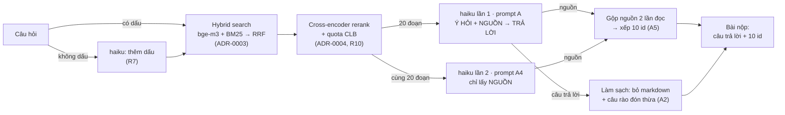

# S2B RAG: hỏi đáp về cộng đồng S2B (NeoRAG Cup 2026)

Hệ thống RAG trả lời câu hỏi về cộng đồng S2B: CLB Lập Trình PTIT (ProPTIT), CLB Multimedia PTIT (MPC) và CLB Nhà
Sáng Tạo Game PTIT (GCC). Repo gồm pipeline nộp bài và một chatbot web để demo.

Thể lệ cuộc thi, dữ liệu và bộ chấm của Ban tổ chức: [docs/competition.md](docs/competition.md).

| | Public Test |
|---|---|
| Baseline của Ban tổ chức | 52.40 |
| **Bài này (public #9)** | **89.15**: retrieval 93.93 · generation 84.38 |

Chỉ dùng `claude-haiku-5-5` qua gateway (không truyền `temperature`), embedding `bge-m3` qua gateway và reranker
open-source `BAAI/bge-reranker-v2-m3` chạy trên máy. Không hard-code đáp án hay `retrieved_ids`.

---

## 1. Kiến trúc



| Bước | Làm gì | Vì sao (số đo) | Tài liệu |
|---|---|---|---|
| Thêm dấu (R7) | Câu **không dấu** được haiku viết lại có dấu; tìm bằng cả câu viết lại và câu gốc | 48% câu public không dấu; reranker gần như không hiểu câu không dấu | ADR-0002, ADR-0004 |
| Hybrid search | `bge-m3` (theo nghĩa) + BM25 bỏ dấu, cụm 2 âm tiết (theo từ khóa), gộp bằng RRF; index có tiền tố CLB + bí danh | Hai cách tìm bù cho nhau; câu không dấu giảm trọng số dense | ADR-0003 |
| Rerank + quota CLB | Cross-encoder chấm lại top‑20 (chỉ câu có dấu); câu hỏi nhiều CLB thì mỗi CLB có ít nhất một đoạn trong top‑5 | dev 0.867 → 0.905 | ADR-0004 |
| haiku trích nguồn (R9) | haiku đọc **20 đoạn**, ghi từng ý của câu hỏi kèm nguồn; đoạn được trích được đưa lên top‑5 | Cross-encoder chấm từng đoạn riêng nên câu nhiều ý thiếu đoạn; public retrieval 81.8 → 89.6 | ADR-0005 |
| Ensemble nguồn (A5) | Lần đọc thứ 2 (prompt "ghi mọi nguồn cho từng ý") chỉ để lấy nguồn; gộp với lần 1, câu trả lời vẫn của lần 1 | Đoạn được trích là gold 82%, ô lấp theo retriever chỉ 1.2%; public retrieval 91.73 → 93.93 | ADR-0005, ADR-0008 |
| Hậu xử lý (G2, A2) | Bỏ markdown; bỏ câu rào đón thuần ở cuối ("Tài liệu không ghi …") bằng code | Judge chấm câu rào đón là "incorrect" 33%; 1 − Noise public 87.18 → 92.74 | ADR-0007 |

**Số lần gọi haiku mỗi câu (bài nộp):** thường 2 lần, thêm 1 lần nếu câu không dấu; câu trả lời rỗng có thể gọi lại 1 lần. Đo thật trên 40 câu mới
(`holdout_casual`): ~0.002 USD và ~7.8 s mỗi câu (gọi lần lượt).

## 2. Kết quả

### Hành trình điểm Public Test

| Bài nộp | Thay đổi chính | Public |
|---|---|---|
| Baseline BTC | dense `bge-m3` top‑5 + haiku | 52.40 |
| #1 | Hybrid BM25 + `bge-m3`, làm giàu index, boost CLB, cross-encoder rerank, prompt viết gọn | 75.53 |
| #2 | + haiku thêm dấu cho câu không dấu (R7) | 80.15 |
| #3 | + quota CLB sau reranker (R10), prompt giảm thông tin thừa (G5) | 79.80 |
| #4 | + haiku trích nguồn, đưa đoạn được trích lên top‑5 (R9) | 85.09 |
| #5 | + haiku đọc 20 đoạn (E1), prompt bớt rào đón (E2) | 87.02 |
| #6 | + nguồn theo từng ý "Ý HỎI" (A) | 87.36 |
| #7 | + bỏ câu rào đón thừa bằng code (A2, 0 USD) | 88.17 |
| #9 | + gộp nguồn của 2 lần đọc (A5) | 89.15 |
| #13 | + đoạn được cả 2 lần đọc chọn đứng đầu top‑5 (R11, 0 USD) | 89.42 |
| #15 | + kiểm tra bằng chứng toàn corpus cho câu bị gắn cờ (R12), retrieval 94.50 → 94.82 | 89.36 (judge lệch, câu trả lời = #13) |
| #16 | R12 + chọn câu trả lời đồng thuận MBR (0 USD) | 89.59 |
| **#17** | **+ sinh lại câu trả lời khi R12 bổ sung đoạn, giữ nguồn câu trả lời dùng** | **89.99** (nộp lại 89.92) |

Đã thử nhưng bỏ (có số liệu): A3 cắt rào đón mạnh hơn (#8, 87.88), A4 prompt "kể đủ" (trượt điều kiện trên dev),
A6 lần đọc thứ 3 (#10, retrieval y hệt #9), A7 tìm lại theo từng ý (đoạn lấp mới chỉ 2.5% là gold). Judge của BTC
không tất định: nộp lại đúng file #7 được 87.99 thay vì 88.17.

### Chi tiết bài #9

| Retrieval | | Generation | |
|---|---|---|---|
| Recall@5 | 92.58 | String Presence | 96.15 |
| MRR@5 | 96.43 | ROUGE-L | 60.84 |
| NDCG@5 | 92.77 | Groundedness | 100 |
| | | Response Relevancy | 57.40 |
| | | 1 − Noise Sensitivity | 91.88 |
| | | Abstention | 100 |

### Cách đánh giá mà không overfit public (ADR-0001)

Public chỉ có 42 câu và điểm judge không tất định, nên mọi thay đổi được đo trước trên các tập tách từ train
(seed 2026):

- `dev` (86 câu) và `holdout` (40 câu); bản `*_noaccent` và `*_casual` (bỏ dấu, teencode, bỏ "?"; bảng teencode tự
  viết, không lấy từ câu public) để giống câu hỏi public.
- Retrieval đo miễn phí (không gọi LLM); generation đo bằng `--no-judge`; judge chỉ dùng ở mốc quan trọng.
- `dev_casual` dự đoán đúng mức tăng của R9 trên public: +7.5 so với +7.7 thực tế.

Mọi lần đo ghi trong [`experiments/log.csv`](experiments/log.csv).

## 3. Cài đặt

Cần Python 3.10+, key gateway do BTC cấp, và **GPU NVIDIA** cho reranker (chạy CPU được nhưng chậm hơn nhiều).

```bash
conda create -n neorag python=3.12 -y
conda activate neorag
python scripts/install.py --local    # cài repo + PyTorch (CUDA nếu có GPU) + sentence-transformers
cp .env.example .env                  # điền OPENAI_API_KEY bằng key BTC cấp
```

Lần chạy đầu tiên tải model reranker `BAAI/bge-reranker-v2-m3` từ Hugging Face; các lần sau nạp từ cache (~30 s).

## 4. Chạy pipeline (tạo bài nộp)

Luôn chỉ định `--pipeline`; nếu không, runner của BTC chạy pipeline baseline.

```bash
neorag run public_test  --pipeline s2b_rag.pipeline:S2BPipeline     # → outputs/public_test_submission.zip
neorag run private_test --pipeline s2b_rag.pipeline:S2BPipeline     # ngày thi, sau khi BTC công bố câu hỏi
neorag run train        --pipeline s2b_rag.pipeline:S2BPipeline --no-judge   # chấm nhanh trên train
```

`--no-judge` chỉ bỏ bước chấm bằng LLM; lệnh `run` vẫn gọi haiku để tạo câu trả lời khi cache chưa có.
Theo diễn tập A5 (~0.002 USD/câu), 42 câu mới ước khoảng 0.08–0.09 USD và 126 câu khoảng 0.25 USD;
hãy kiểm tra số dư gateway trước khi chạy.

Kết quả gọi haiku qua `LLMClient` được cache trong `.cache/`: chạy lại cùng câu hỏi và cùng cấu hình đã tái lập
bài #9 đúng 42/42 câu, không tốn thêm tiền. Clone mới không có cache sẽ gọi haiku thật; đầu ra có thể khác.
Luồng chatbot dùng streaming trực tiếp và không dùng cache câu trả lời này (ADR-0010).

`S2BPipeline` là cấu hình nộp bài. Các bản thử nghiệm cũ vẫn chạy được để tái lập từng bài nộp, ví dụ
`--pipeline s2b_rag.pipeline:S2BPipelineA2` (bài #7).

## 5. Chạy chatbot

```bash
python -m s2b_rag.web                 # nạp reranker ~30 s, rồi mở http://127.0.0.1:8000
python -m s2b_rag.web --port 8080     # đổi cổng
```

Chatbot dùng **cùng retrieval và cùng prompt trả lời** với bài nộp, nhưng chỉ gọi haiku lần 1 (lần đọc thứ 2 của A5
chỉ phục vụ danh sách id nộp bài):

- **Stream** câu trả lời; phần nội bộ "Ý HỎI … NGUỒN" của prompt được giấu khi stream.
- Hiện câu hỏi đã được hiểu ("Hiểu câu hỏi là …"), các đoạn đã xem theo CLB, và **nguồn được dùng để trả lời**.
- **Câu xã giao** ("hello", "cảm ơn", "bạn là ai") và câu không phải câu hỏi ("1 + 1") được trả lời ngay, không gọi
  haiku. Câu không dấu như "ni hao" được haiku hiểu thành "Xin chào" rồi trả lời ngay, không gọi bước trả lời.
- **Câu ngoài phạm vi** được từ chối dựa trên tài liệu, không để LLM tự trả lời bằng kiến thức riêng.
- **Memory ngắn hạn:** trình duyệt gửi kèm 2 lượt hỏi đáp gần nhất; haiku viết lại câu nối tiếp ("thế còn GCC thì
  sao?") thành câu đầy đủ trước khi tìm kiếm. Không lưu gì ở server; tải lại trang là cuộc trò chuyện mới.
- Giao diện sáng/tối, dùng được trên điện thoại. Backend Starlette + uvicorn, frontend HTML/CSS/JS thuần.

Chatbot thường gọi haiku 1 lần để trả lời; câu không dấu hoặc câu nối tiếp cần thêm 1 lần viết lại. Ước tính
~0.001–0.002 USD/câu dựa trên các lần chạy trước; chưa đo chi phí và độ trễ riêng cho chatbot A5 (ADR-0009).

## 6. Đo và thử nghiệm

```bash
python -m s2b_rag.eval.split                                              # tạo experiments/splits/ (dev, holdout, *_noaccent, *_casual)
python -m s2b_rag.eval.retrieval --retriever hybrid_rerank --splits dev dev_casual   # chỉ đo retrieval, không gọi LLM
neorag run experiments/splits/dev_casual.jsonl --pipeline s2b_rag.pipeline:S2BPipeline --no-judge
pytest && ruff check .
```

`--retriever hybrid_r10` (cấu hình nộp bài) có thêm bước haiku thêm dấu cho câu không dấu; kết quả được cache nên
đo lại không tốn thêm.

## 7. Cấu trúc mã nguồn

```
src/s2b_rag/
├── pipeline.py          S2BPipeline (= A5) và các lớp thí nghiệm R9 → A6; retrieve/stream_answer cho chatbot
├── generate.py          prompt, tách "Ý HỎI"/NGUỒN, xếp tầng nguồn, hậu xử lý, bộ lọc stream
├── query.py             haiku viết lại câu hỏi (thêm dấu, R7)
├── textnorm.py          bỏ dấu, tách từ, mở rộng viết tắt
├── aliases.py           bí danh CLB, nhận diện CLB trong câu hỏi
├── retrieval/           bm25, dense (bge-m3), fusion (RRF), club_boost, rerank, rewrite, presets
├── eval/                split (tạo tập dev/holdout), retrieval (đo miễn phí), explog (ghi log.csv)
└── web/                 chatbot: server (Starlette), smalltalk, memory, static/index.html
tests/                   pytest cho pipeline, retrieval, chatbot
docs/adr/                quyết định kỹ thuật kèm số liệu và đánh đổi
experiments/             log.csv (mọi lần đo), splits/ (tập dev/holdout)
```

Code của Ban tổ chức (`src/neorag/`: runner, bộ chấm, client) và `configs/eval.toml` được giữ nguyên.

## 8. Tài liệu

| Tài liệu | Nội dung |
|---|---|
| [ADR-0001](docs/adr/0001-evaluation-splits-dev-holdout-casual.md) | Tập dev/holdout, bản bỏ dấu và bản "đời thường" |
| [ADR-0002](docs/adr/0002-query-normalization-rule-vs-llm.md) | Chuẩn hoá câu hỏi bằng luật và haiku cho câu không dấu |
| [ADR-0003](docs/adr/0003-hybrid-bm25-dense-rrf.md) | Hybrid retrieval: bge-m3 + BM25 bỏ dấu, RRF |
| [ADR-0004](docs/adr/0004-local-reranker-accented-only.md) | Cross-encoder chạy trên máy, chỉ cho câu có dấu |
| [ADR-0005](docs/adr/0005-llm-cited-evidence-rerank.md) | haiku trích nguồn để xếp top‑5 (R9, A, A2, A5) |
| [ADR-0006](docs/adr/0006-ten-retrieved-ids.md) | Chọn và xếp 10 id nộp bài |
| [ADR-0007](docs/adr/0007-answer-style-and-abstention.md) | Phong cách trả lời, rào đón và từ chối |
| [ADR-0008](docs/adr/0008-llm-call-budget.md) | Hai lần đọc nguồn của A5 và ngân sách |
| [ADR-0009](docs/adr/0009-chatbot-streaming.md) | Chatbot Starlette, streaming và memory |
| [ADR-0010](docs/adr/0010-reproducibility.md) | Tái lập kết quả từ commit, cấu hình và cache |
| [docs/competition.md](docs/competition.md) | Thể lệ cuộc thi (README gốc của Ban tổ chức) |
| [docs/evaluation.md](docs/evaluation.md) | Cách bộ chấm tính từng metric |
| [docs/gitflow.md](docs/gitflow.md) | Quy ước nhánh và commit |
